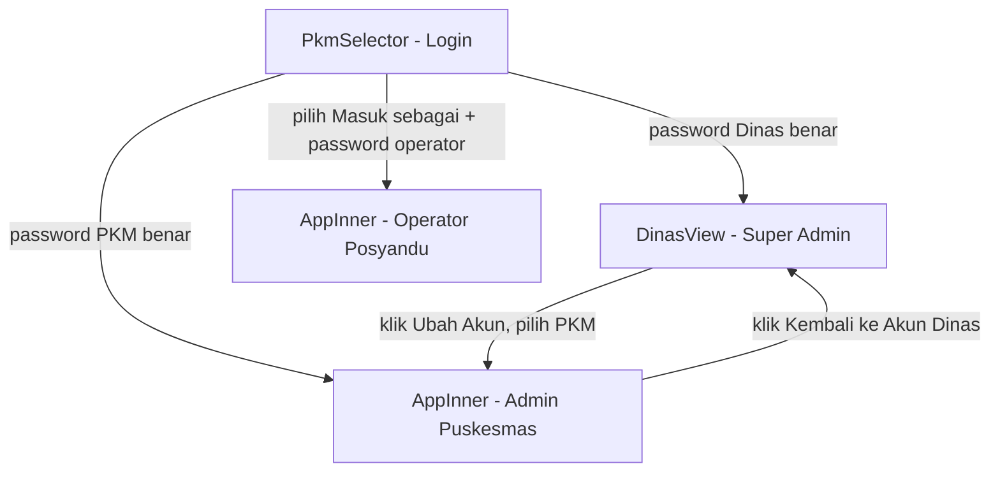

# Skema Akun & Akses — Fitur "Ubah Akun" untuk Admin Dinas

Dokumen ini menjelaskan (1) perubahan yang ditambahkan agar **akun Dinas Kesehatan**
bisa berpindah ke tampilan Puskesmas manapun **tanpa memasukkan username/password**,
dan (2) skema data yang dipakai, supaya mudah diubah/diperluas di kemudian hari.

---

## 1. Apa yang ditambahkan

| Bagian | Fungsi/Komponen | Keterangan |
|---|---|---|
| Modal pemilih akun | `SwitchAccountPanel()` | Meniru tampilan "PANEL UBAH AKUN" — search box + daftar (0) Pusat Dinas Kesehatan dan (1)…(50) Puskesmas |
| Tombol pemicu | `⚙️ Ubah Akun` di sidebar `DinasView` | Hanya tampil untuk akun Dinas (super admin) yang sudah login |
| Loncat akun | `switchAccountAsDinas(name)` di `Root()` | Langsung memanggil `choosePkm(name, null)` **tanpa** memanggil `getAccountPassword()` |
| Kembali ke Dinas | `returnToDinasFromSwitch()` di `Root()` + tombol `🔁 Kembali ke Akun Dinas` di `AppInner` | Kembali ke akun Dinas tanpa login ulang, karena sesi Dinas belum pernah ditutup |
| Penanda sesi | `dinas-switch-active` (sessionStorage) | Menandai bahwa PKM yang sedang aktif "dipinjam" dari sesi Dinas |

### Mengapa ini aman
Hak "loncat akun tanpa password" **hanya** tersedia di dalam `DinasView`. Komponen ini
cuma bisa dicapai kalau `PkmSelector.doLogin()` sudah memverifikasi password Dinas lewat
`getAccountPassword(accountSlug(DINAS_ENTITY))`. Jadi:

- Puskesmas **tidak** mendapat tombol ini — mereka tetap harus login normal.
- Password tiap Puskesmas (`PKM_DEFAULT_PASSWORDS` / `account-pwd:<slug>`) **tidak diubah**
  dan tetap berlaku kalau ada yang login langsung sebagai PKM tersebut.
- Fitur ini murni "role akses" tambahan di sisi klien untuk 1 sesi Dinas yang sudah sah,
  bukan celah baru bagi pihak yang belum login.

---

## 2. Skema akun & peran (role) saat ini

| Peran | Entity/slug | Sumber password | Bisa loncat akun tanpa password? |
|---|---|---|---|
| Admin Dinas (Super Admin) | `DINAS_ENTITY` / `admindinas` | `account-pwd:admindinas` atau default `dinas2026` | Bisa loncat ke **semua** akun Puskesmas |
| Admin Puskesmas | nama PKM / `slugifyPkm(nama)` | `account-pwd:<slug-pkm>` atau `PKM_DEFAULT_PASSWORDS[slug]` | Tidak (harus login sendiri-sendiri) |
| Operator Posyandu | id operator (`op-...`) di bawah 1 PKM | field `password` di `operator-accounts:<slug-pkm>` | Tidak |

---

## 3. Skema kunci penyimpanan (window.storage)

Semua data **aplikasi** disimpan lewat `window.storage` (server bersama, `shared:false`
kecuali disebutkan lain), memakai pola kunci `namespace:pengenal`.

| Kunci | Isi | Dipakai oleh |
|---|---|---|
| `account-pwd:<slug>` | Password aktif akun (override dari default) | Semua akun (Dinas & 50 PKM) |
| `operator-accounts:<slug-pkm>` | Array akun Operator Posyandu (id, name, posy, desa, password) | Admin Puskesmas, `PkmSelector` |
| `role:<slug-pkm>` | Peran akun PKM (`admin` dsb) | `AppInner` |
| `assigned-posy:<slug-pkm>` / `assigned-desa:<slug-pkm>` | Kunci filter akun PKM ke 1 Posyandu/Desa | `AppInner` |
| `bayi-records:<slug-pkm>` | Data basis sasaran bayi per PKM | `AppInner`, rekap Dinas |
| `pusdatin-target:<slug-pkm>` | Target sasaran Pusdatin per PKM | Dinas, rekap kabupaten |
| `sasaran-desa-override:<slug-pkm>` | Override target sasaran per desa | Dinas, rekap per desa |

**Skema sesi (browser, bukan server)** — disimpan di `sessionStorage`, bukan
`localStorage`, supaya tidak "ikut login" ke PC lain (lihat komentar di kode):

| Kunci sesi | Isi | Ditulis oleh |
|---|---|---|
| `selected-pkm` | Nama entity yang sedang aktif (`DINAS_ENTITY` atau nama PKM) | `choosePkm()` |
| `selected-operator-id` | id operator jika login sebagai sub-akun Operator | `choosePkm()` |
| `dinas-switch-active` | `true` bila PKM aktif sedang "dipinjam" dari sesi Dinas | `switchAccountAsDinas()` / `returnToDinasFromSwitch()` |

Semua kunci sesi ini dibungkus `{ v: value, exp: timestamp }` dengan masa berlaku
`SESSION_TTL_MS = 8 jam`, dan otomatis dianggap kosong kalau lewat waktu.

---

## 4. Panduan bila skema berubah nanti

Gunakan daftar ini sebagai checklist tiap kali menambah **peran baru** atau
**mengubah cara autentikasi**:

1. **Menambah peran baru (mis. "Supervisor Kecamatan")**
   - Tambah cabang di `accountSlug()` / `accountLabel()` bila peran ini punya akun
     tersendiri (bukan sub-akun PKM).
   - Tentukan apakah peran ini juga berhak memakai `SwitchAccountPanel` — kalau ya,
     tambahkan prop `onSwitchAccount` ke komponen tampilannya (seperti di `DinasView`)
     dan panggil `switchAccountAsDinas()`, atau buat fungsi serupa
     `switchAccountAsSupervisor()` yang membatasi daftar PKM sesuai wilayah.
   - **Jangan** memberi hak loncat-tanpa-password ke peran yang levelnya di bawah PKM
     (Operator), karena akan menembus batas kunci Posyandu/Desa yang sudah diatur.

2. **Mengubah pola kunci `window.storage`**
   - Ganti nama kunci di SATU tempat (biasanya sudah dikumpulkan sebagai
     `` `namespace:${slug}` ``), lalu jalankan pencarian teks untuk memastikan semua
     pemanggil (`get`/`set`/`list`) memakai pola baru yang sama.
   - Karena `window.storage` dibagikan ke seluruh 50 Puskesmas + Dinas, sediakan
     migrasi baca-lama/tulis-baru dua arah sebelum kunci lama dihapus, supaya data
     yang sudah ada tidak hilang saat peralihan.

3. **Mengubah masa berlaku sesi atau menambah kunci sesi baru**
   - Ubah `SESSION_TTL_MS` di `Root()` — berlaku untuk semua kunci sesi termasuk
     `dinas-switch-active`.
   - Kunci sesi baru **harus** ditulis lewat `writeLocalSession()` /
     dibaca lewat `readLocalSession()` (bukan langsung `sessionStorage`), agar ikut
     format `{v, exp}` dan ikut kedaluwarsa otomatis.
   - Saat menghapus sesi (logout / kembali), pastikan `changePkm()` juga membersihkan
     kunci sesi baru tersebut — persis seperti `dinas-switch-active` dibersihkan di sana.

4. **Mengubah daftar Puskesmas (`PKM_LIST`)**
   - `SwitchAccountPanel` membaca `PKM_LIST` secara langsung, jadi menambah/menghapus
     Puskesmas otomatis terlihat di Panel Ubah Akun tanpa perlu ubah kode panel.
   - Pastikan `slugifyPkm()`, `KECAMATAN_MAP`, `JUMLAH_PENDUDUK_MAP`, dan
     `PKM_DEFAULT_PASSWORDS` tetap 1:1 index dengan `PKM_LIST` yang baru.

---

## 5. Lokasi kode (untuk referensi cepat)

- `SwitchAccountPanel` — komponen modal "Panel Ubah Akun".
- `Root()` — state `dinasSwitchActive`, fungsi `switchAccountAsDinas()` dan
  `returnToDinasFromSwitch()`.
- `DinasView` — tombol `⚙️ Ubah Akun` dan pemasangan `SwitchAccountPanel`.
- `AppInner` — tombol `🔁 Kembali ke Akun Dinas` (tampil hanya jika `dinasSwitchActive`).
